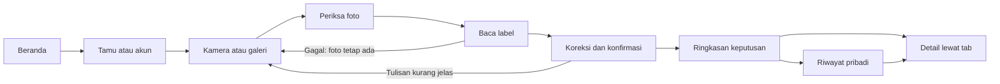

# QA BongkarLabel

Tanggal: 17 Oktober 2026. Target: aplikasi Docker di localhost:3001. Akun dan sesi QA dipisahkan dari akun pengguna. Gambar uji adalah fixture label terkontrol, bukan pembuktian akurasi semua kemasan.

## Identitas dan prioritas UI

Identitas Indeks Belanja memakai mulberry, rose, citron dan Work Sans. Beranda mengarahkan ke scan tanpa akun; kamera menjadi metode utama. Galeri dan formulir lengkap tersedia sebagai jalur pendamping. Hasil menampilkan keputusan dan angka gizi ringkas sebelum detail. Ukuran layar yang diperiksa meliputi 320, 390, 768 dan 1440 px; beranda juga diperiksa pada 1280 dan 1600 px.

## Urutan perjalanan pengguna



| ID    | Alur                                                | Hasil yang diperiksa                                                                                                             |
| ----- | --------------------------------------------------- | -------------------------------------------------------------------------------------------------------------------------------- |
| QA-01 | Beranda → Scan label → sesi tamu                    | Kamera menjadi metode utama; profil awal tidak mengasumsikan kondisi medis; sesi dipakai kembali.                                |
| QA-02 | Daftar akun → profil opsional → kembali ke tujuan   | Profil tamu tetap ada; tujuan awal dipertahankan; login dan pencabutan sesi berfungsi.                                           |
| QA-03 | Izinkan kamera → foto → periksa/perbesar → tutup    | JPEG nyata terbentuk; kamera berhenti saat pemeriksaan; fokus kembali; foto tersimpan saat berganti metode.                      |
| QA-04 | Kamera ditolak → galeri                             | Pesan dapat ditindaklanjuti; galeri dapat dipakai tanpa kehilangan pilihan sebelumnya.                                           |
| QA-05 | Galeri valid/tidak valid → Baca foto                | Maksimal dua foto, ukuran/format diperiksa; server menolak file palsu dan gambar terlalu kecil.                                  |
| QA-06 | Pembacaan gagal → ulangi dengan foto yang sama      | Pesan gagal terlihat; tombol aktif kembali; pilihan foto tetap ada; ulangi mencapai tahap tinjau.                                |
| QA-07 | OCR → koreksi → konfirmasi → analisis               | Nilai yang hilang wajib diisi; perubahan membatalkan konfirmasi; tidak ada analisis sebelum konfirmasi; harga kosong tetap null. |
| QA-08 | Foto kamera → OCR/AI nyata → hasil                  | Enam nutrien fixture cocok dengan acuan; 9Router benar-benar digunakan; batas pengujian dicatat.                                 |
| QA-09 | Hasil ringkas → Komposisi → Sumber gula → pengganti | Ringkasan tampil pertama; detail dapat dibuka; alasan, satuan dan batas perbandingan tetap terlihat.                             |
| QA-10 | Tab hasil → Back/Forward browser                    | URL dan tab yang tampil tetap sinkron; kembali dari detail membuka ringkasan.                                                    |
| QA-11 | Riwayat → tautan detail → muat ulang                | Snapshot dan profil asli dipulihkan; hash tab pada tautan langsung tetap dihormati setelah reload.                               |
| QA-12 | Cari riwayat → kosong → reset → hapus               | Pencarian literal, tanpa perluasan regex; kosong berbeda dari belum punya riwayat; hapus memerlukan konfirmasi.                  |
| QA-13 | Pengguna lain → riwayat milik pemilik               | Daftar, pencarian, detail dan penghapusan tidak membuka data milik pengguna lain.                                                |
| QA-14 | Kamus/profil/riwayat gagal dimuat → coba lagi       | Status memuat, pesan gagal dan tombol pemulihan berfungsi.                                                                       |
| QA-15 | Mobile 320/390, tablet 768, desktop 1440            | Tidak ada halaman melebar; kontrol dapat dijangkau; dialog dapat ditutup; keyboard dan fokus bekerja.                            |
| QA-16 | Akhiri sesi → akses halaman pribadi                 | Keluar kembali ke beranda; sesi lama tidak dapat dipakai untuk membuka data pribadi.                                             |

## Jenis bukti

- Uji browser produksi memeriksa interaksi nyata. Respons yang sengaja disimulasikan hanya dipakai untuk memeriksa kegagalan dan gerbang tinjau, serta dibedakan dari uji AI nyata.
- Kamera virtual menghasilkan JPEG melalui browser. Ini tidak menggantikan pengujian kamera fisik Safari/iOS dan Chrome/Android.
- Uji AI nyata memakai fixture dengan acuan enam nutrien. Hasilnya tidak menjadi jaminan seluruh gambar, merek atau kondisi pencahayaan.
- Laporan akhir mencatat temuan awal, tindakan koreksi dan pengujian ulang. Tidak ada klaim lolos sebelum hasil pengujian selesai.

## Menjalankan ulang

Dengan aplikasi produksi sudah aktif di port 3001:

Fixture browser disertakan di tests/fixtures, sehingga tidak bergantung pada folder artifacts dari komputer pengembang. Instal dependensi proyek dan browser Playwright terlebih dahulu bila menjalankan pada checkout baru.

```sh
TEST_BASE_URL=http://localhost:3001 PLAYWRIGHT_NO_VIDEO=1 npm run test:browser
```

Skenario koneksi gagal menggunakan respons uji terkontrol. Skenario QA-08 dijalankan terpisah menggunakan kamera virtual berisi fixture label dan endpoint produksi nyata. Bukti lokalnya adalah artifacts/camera-ai-end-to-end.json. Jangan menyamakan seluruh uji browser dengan uji akurasi AI atau pengujian perangkat fisik.
